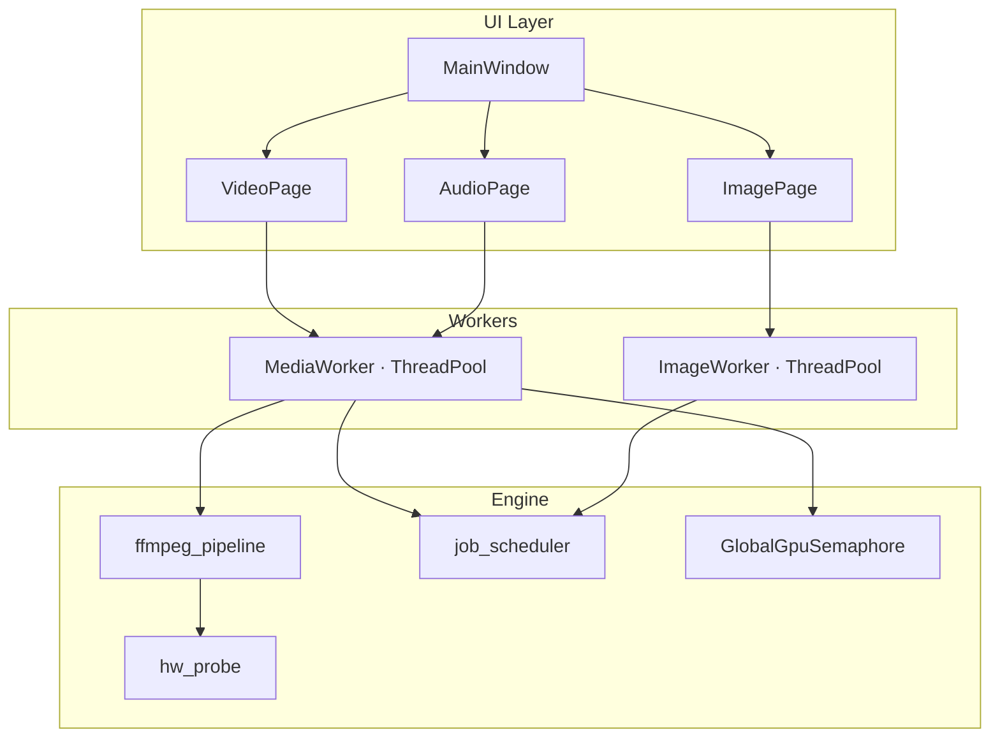
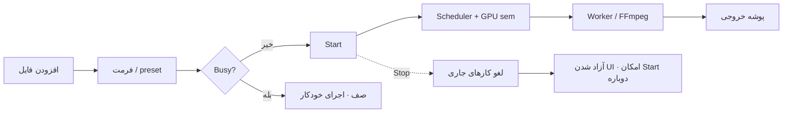

<p align="center">
  
</p>

<h1 align="center">Galaxy Media Pro</h1>

<p align="center">
  <strong>تبدیل ساده تصویر، ویدیو و صدا — با شتاب سخت‌افزار و موازی‌سازی هوشمند</strong>
</p>

<p align="center">
  <em>Simple image, video &amp; audio conversion — hardware acceleration &amp; smart parallelism</em>
</p>

<p align="center">
  <a href="README.md">English</a> ·
  <a href="README.fa.md"><strong>فارسی</strong></a>
</p>

<p align="center">
  نسخه <strong>3.0 Pro</strong> · Windows · PySide6 · FFmpeg GPL
</p>

<p align="center">
  <a href="https://github.com/Ali-Rashidi-80/MediaConverterPro/actions/workflows/qa.yml"></a>
  
  
  
  
  
</p>

<p align="center">
  <a href="docs/INDEX.md">مستندات</a> ·
  <a href="docs/USER_GUIDE.md">راهنمای کاربر</a> ·
  <a href="docs/INSTALL.md">نصب</a> ·
  <a href="LICENSE">License</a> ·
  <a href="CONTRIBUTING.md">مشارکت</a>
</p>

---

**Galaxy Media Pro** یک مبدل دسکتاپ دو زبانه برای ویندوز است: **تصویر (Pillow)**، **ویدیو** و **صدا (FFmpeg)** در یک اپ PySide6. انکودرهای NVIDIA / AMD / Intel را تشخیص می‌دهد، tier امن pipeline را انتخاب می‌کند و با موازی‌سازی هوشمند کار را زمان‌بندی می‌کند — تا کاربر تبدیل کند، نه با CLI درگیر شود.

> نسخهٔ پیش‌فرض انگلیسی: [README.md](README.md)

---

## فهرست مطالب

- [چرا Galaxy Media Pro؟](#چرا-galaxy-media-pro)
- [قابلیت‌ها](#قابلیت‌ها)
- [شروع سریع](#شروع-سریع)
- [پشتهٔ فناوری](#پشتهٔ-فناوری)
- [ساختار پروژه](#ساختار-پروژه)
- [معماری](#معماری)
- [گردش‌کار تبدیل](#گردش‌کار-تبدیل)
- [فرمت‌های پشتیبانی‌شده](#فرمت‌های-پشتیبانی‌شده)
- [شتاب سخت‌افزار](#شتاب-سخت‌افزار)
- [استفاده (کاربر نهایی)](#استفاده-کاربر-نهایی)
- [مستندات](#مستندات)
- [کیفیت و CI](#کیفیت-و-ci)
- [عیب‌یابی](#عیب‌یابی)
- [توسعه‌دهنده](#توسعه‌دهنده)
- [مشارکت](#مشارکت)
- [امنیت](#امنیت)
- [مجوز و attribution](#مجوز-و-attribution)
- [آرشیو](#آرشیو)
- [کلون / Git](#کلون--git)

---

## چرا Galaxy Media Pro؟

| درد | پاسخ اپ |
|-----|---------|
| فلگ‌های FFmpeg سخت‌اند | یک رابط برای تصویر، ویدیو و صدا |
| GPU وابسته به وندور است | Auto NVENC · AMF · QSV با fallback به CPU |
| موازی‌سازی می‌تواند GPU را خراب کند | `GlobalGpuSemaphore` + Smart / Parallel / Sequential |
| نصب دردسر دارد | یک EXE قابل‌حمل با FFmpeg داخلی |
| تیم‌های دو زبانه | **فارسی RTL** + **English LTR** داخلی |

---

## قابلیت‌ها

| قابلیت | توضیح |
|--------|--------|
| **سه رسانه، یک رابط** | تصویر (PIL) · ویدیو/صدا (FFmpeg) در یک اپ یکپارچه |
| **شتاب GPU** | NVENC · AMF · QSV — تشخیص خودکار، fallback به CPU |
| **Tier هوشمند** | Full GPU · Encode-only GPU · Remux · CPU |
| **موازی‌سازی** | Sequential · Parallel · Smart (بر اساس CPU/GPU) |
| **دو زبان** | فارسی RTL + English LTR |
| **Portable** | یک EXE با FFmpeg داخلی — بدون نصب |
| **حالت Pro** | کنترل‌های بیشتر، Performance، presetهای NVENC |
| **چرخهٔ امن** | Start/Stop/rerun، صف حین busy، shutdown thread-safe |

---

## شروع سریع

### پیش‌نیاز

- Windows 10/11 · Python **3.11+** (برای توسعه؛ **3.12** توصیه)
- `ffmpeg.exe` در ریشه پروژه ([راهنمای FFmpeg](docs/FFMPEG_BUNDLE.md))

### اجرا از سورس

```powershell
git clone https://github.com/Ali-Rashidi-80/MediaConverterPro.git
cd MediaConverterPro
pip install -r requirements.txt
python galaxy_ultimate.py
```

### ساخت Portable (یک فایل)

```powershell
.\build.bat
# یا: .\build_portable.bat
# خروجی: dist\GalaxyMediaPro_Portable.exe
```

ساخت پوشه‌ای (onedir):

```powershell
.\build_onedir.bat
```

### QA کامل (توسعه‌دهندگان)

```powershell
pip install -r requirements-dev.txt
.\tools\run_qa.ps1 --full
# یا: python tools/qa_full.py --full
```

جزئیات نصب و build: [docs/INSTALL.md](docs/INSTALL.md)

---

## پشتهٔ فناوری

| لایه | فناوری |
|------|--------|
| UI | PySide6 (Qt) · i18n دو زبانه |
| تصویر | Pillow · اختیاری `pillow-heif` (HEIC) |
| ویدیو / صدا | FFmpeg GPL (`ffmpeg.exe`) |
| بسته‌بندی | PyInstaller · UPX (روی exe؛ نه روی FFmpeg) |
| کیفیت | pytest · pytest-qt · Ruff · MyPy · Bandit · GitHub Actions |
| فونت | Vazirmatn (باندل در `fonts/`) |

---

## ساختار پروژه

```
MediaConverterPro/
├── galaxy/                 # ← موتور اصلی (UI + services + workers)
│   ├── core/               # constants, paths, utils, exceptions
│   ├── services/           # ffmpeg, pipeline, hw_probe, scheduler, settings
│   ├── workers/            # media_worker, image_worker, image_task
│   └── ui/                 # main_window, pages, theme, widgets
├── galaxy_i18n.py          # ترجمه FA/EN
├── galaxy_fonts.py         # فونت Vazirmatn + typography
├── galaxy_ultimate.py      # entry point (PyInstaller)
├── tests/                  # 249 تست pytest
├── tools/                  # verify, benchmark, qa_full, bootstrap
├── docs/                   # مستندات کامل (EN پیش‌فرض + FA)
├── fonts/                  # فونت‌های باندل
├── ffmpeg.exe              # FFmpeg GPL (ضروری)
├── ffprobe.exe             # برای تست integration
├── archive/                # کد legacy — بدون استفاده در build
├── build.bat               # پیش‌فرض → portable onefile
├── build_portable.bat
├── build_onedir.bat
├── GalaxyConverter.portable.spec
├── LICENSE
├── CONTRIBUTING.md
├── SECURITY.md
├── pyproject.toml
└── requirements.txt
```

---

## معماری



جزئیات کامل: [docs/ARCHITECTURE.md](docs/ARCHITECTURE.md)

---

## گردش‌کار تبدیل



---

## فرمت‌های پشتیبانی‌شده

| نوع | فرمت‌ها |
|-----|---------|
| **تصویر** | JPG · PNG · WEBP · HEIC* · TIFF · GIF · BMP · ICO |
| **ویدیو** | MP4 · MKV · MOV · WEBM · AVI · GIF |
| **صدا** | MP3 · WAV · FLAC · AAC · M4A · OGG · OPUS · WMA |

\* HEIC در صورت نصب `pillow-heif`

---

## شتاب سخت‌افزار

| GPU | Encoder | فیلتر GPU (Tier1) |
|-----|---------|-------------------|
| NVIDIA | h264/hevc NVENC | scale_cuda |
| AMD | h264/hevc AMF | vpp_amf |
| Intel | h264/hevc QSV | scale_qsv |

تنظیمات: **Settings → Pro mode → Performance**  
راهنما: [docs/ARCHITECTURE.md](docs/ARCHITECTURE.md) · بررسی قابلیت: `python tools/verify_ffmpeg_caps.py`

---

## استفاده (کاربر نهایی)

1. فایل اضافه کنید — Drag & Drop، انتخاب فایل، یا پوشه
2. فرمت / preset را ببینید (پیش‌فرض برای بیشتر کارها کافی است)
3. **Start** را بزنید — badge فوتر (encoder · پیشرفت · tier) را دنبال کنید
4. اختیاری: **Stop**، افزودن فایل به صف حین تبدیل، باز کردن پوشه خروجی

راهنمای داخل برنامه: تب **Help** · راهنمای کامل: [docs/USER_GUIDE.md](docs/USER_GUIDE.md)

---

## مستندات

| سند | موضوع |
|-----|--------|
| [docs/INDEX.md](docs/INDEX.md) | فهرست مرکزی مستندات |
| [docs/INSTALL.md](docs/INSTALL.md) | نصب، build، portable |
| [docs/USER_GUIDE.md](docs/USER_GUIDE.md) | راهنمای کاربر |
| [docs/DEVELOPMENT.md](docs/DEVELOPMENT.md) | توسعه و conventions |
| [docs/ARCHITECTURE.md](docs/ARCHITECTURE.md) | معماری فنی |
| [docs/TESTING.md](docs/TESTING.md) | QA و pytest |
| [docs/FFMPEG_BUNDLE.md](docs/FFMPEG_BUNDLE.md) | FFmpeg و GPL |
| [docs/CHANGELOG.md](docs/CHANGELOG.md) | تاریخچه نسخه |
| [CONTRIBUTING.md](CONTRIBUTING.md) | نحوهٔ مشارکت |
| [SECURITY.md](SECURITY.md) | گزارش آسیب‌پذیری |
| [README.md](README.md) | README انگلیسی (پیش‌فرض) |

---

## کیفیت و CI

```powershell
python tools/qa_full.py          # gate روزانه (unit)
python tools/qa_full.py --full   # + integration FFmpeg
python -m pytest tests -q        # 249 tests · ~70% coverage
```

| Gate | ابزار |
|------|--------|
| Lint | Ruff |
| Types | MyPy |
| Security | Bandit |
| Tests | pytest + pytest-qt |
| Acceptance | benchmark_matrix, verify_ffmpeg_caps |

CI: [`.github/workflows/qa.yml`](.github/workflows/qa.yml) — Windows · Python 3.12

صادقانه: gate خودکار regression را می‌گیرد؛ ماتریس واقعی GPU/درایور نیاز به [Manual QA](docs/TESTING.md#manual-qa-pre-release) دارد.

---

## عیب‌یابی

| علامت | راه‌حل |
|-------|--------|
| FFmpeg not found | `ffmpeg.exe` کنار exe / ریشه پروژه یا در `PATH` |
| NVENC غیرفعال | درایور NVIDIA + build GPL با NVENC |
| HEIC کار نمی‌کند | `pip install pillow-heif` |
| Portable کند است | اولین اجرا cache استخراج می‌کند (۱۰–۲۰ث)؛ SSD کمک می‌کند |
| خطای GPU | خودکار CPU؛ Help و لاگ را ببینید |
| Start گیر کرده بعد از لغو | در 3.0 رفع شده — build به‌روز؛ [CHANGELOG](docs/CHANGELOG.md) |

بیشتر: [docs/INSTALL.md](docs/INSTALL.md) · [docs/USER_GUIDE.md](docs/USER_GUIDE.md)

---

## توسعه‌دهنده

| | |
|---|---|
| **نام** | Ali Rashidi |
| **برند** | Write Your Way |
| **کانال تلگرام** | [@writeyourway](https://t.me/writeyourway) |
| **تماس** | [@a_ra_80](https://t.me/a_ra_80) |

اطلاعات کامل در صفحه **راهنما → درباره / Developer** داخل برنامه.

---

## مشارکت

این پروژه proprietary است. مشارکت خارجی **با توافق قبلی** با نویسنده پذیرفته می‌شود.

جزئیات: [CONTRIBUTING.md](CONTRIBUTING.md) · راهنمای توسعه: [docs/DEVELOPMENT.md](docs/DEVELOPMENT.md)

---

## امنیت

آسیب‌پذیری‌های حساس را در issue عمومی باز نکنید. مسیر رسمی: [SECURITY.md](SECURITY.md).

---

## مجوز و attribution

| جزء | مجوز |
|-----|------|
| **کد اپ (Galaxy Media Pro)** | Proprietary — © Ali Rashidi · [LICENSE](LICENSE) |
| **FFmpeg** | GNU GPL — [gyan.dev](https://www.gyan.dev/ffmpeg/builds/) · [BtbN](https://github.com/BtbN/FFmpeg-Builds) |
| **PySide6 / Qt** | LGPL / Qt license |
| **Pillow و وابستگی‌ها** | مجوز هر بسته در PyPI |

Attribution FFmpeg در صفحه **Help → GPL** داخل برنامه.

---

## آرشیو

پوشه `archive/` شامل پروژه Phase 5 قدیمی است — **جزء build فعلی نیست**.  
جزئیات: [archive/README.md](archive/README.md)

---

## کلون / Git

```powershell
git clone https://github.com/Ali-Rashidi-80/MediaConverterPro.git
cd MediaConverterPro
```

`.gitignore` شامل `.cursor/`، `dist/`، `build/` و cacheهای QA است.

---

<p align="center">
  <strong>Galaxy Media Pro 3.0</strong><br>
  Ali Rashidi · <a href="https://t.me/writeyourway">@writeyourway</a> · <a href="https://t.me/a_ra_80">@a_ra_80</a><br>
  <em>ساخته‌شده برای کاربرانی که می‌خواهند تبدیل کنند — نه با FFmpeg CLI درگیر شوند.</em>
</p>
