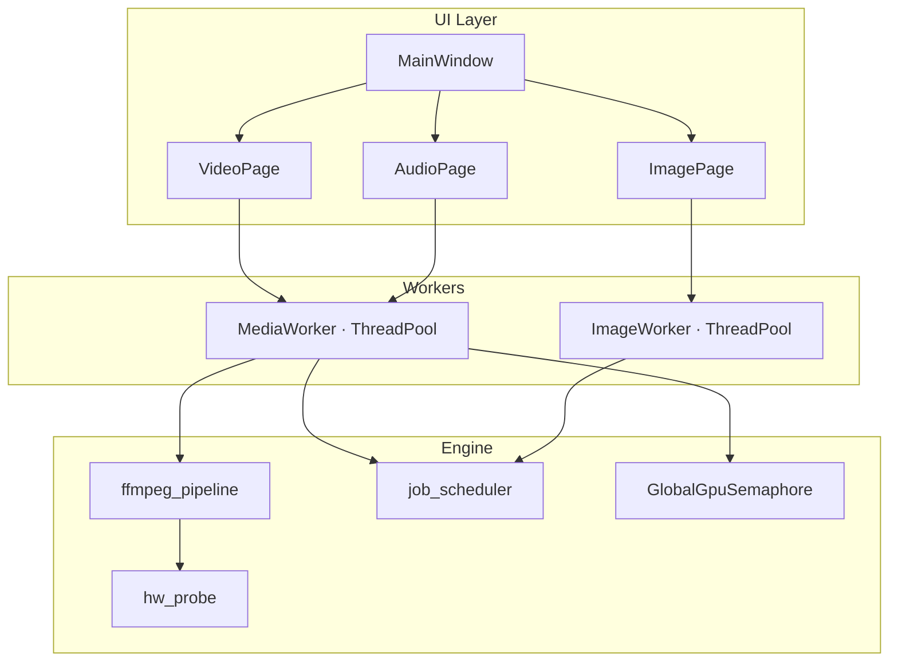
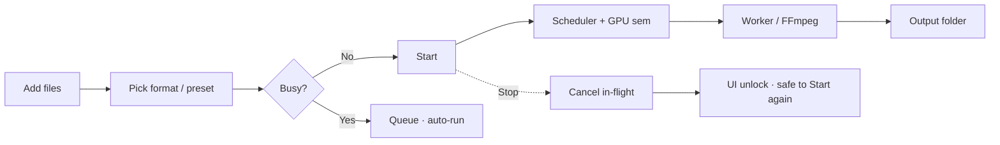

<p align="center">
  
</p>

<h1 align="center">Galaxy Media Pro</h1>

<p align="center">
  <strong>Simple image, video &amp; audio conversion — hardware acceleration &amp; smart parallelism</strong>
</p>

<p align="center">
  <em>تبدیل ساده تصویر، ویدیو و صدا — با شتاب سخت‌افزار و موازی‌سازی هوشمند</em>
</p>

<p align="center">
  <a href="README.md"><strong>English</strong></a> ·
  <a href="README.fa.md">فارسی</a>
</p>

<p align="center">
  Version <strong>3.0 Pro</strong> · Windows · PySide6 · FFmpeg GPL
</p>

<p align="center">
  <a href="https://github.com/Ali-Rashidi-80/MediaConverterPro/actions/workflows/qa.yml"></a>
  
  
  
  
  
</p>

<p align="center">
  <a href="docs/INDEX.md">Docs</a> ·
  <a href="docs/USER_GUIDE.md">User Guide</a> ·
  <a href="docs/INSTALL.md">Install</a> ·
  <a href="LICENSE">License</a> ·
  <a href="CONTRIBUTING.md">Contributing</a>
</p>

---

**Galaxy Media Pro** is a bilingual Windows desktop converter for **images (Pillow)**, **video**, and **audio (FFmpeg)** in one PySide6 app. It auto-detects NVIDIA / AMD / Intel GPU encoders, picks a safe pipeline tier, and schedules jobs with smart parallelism — so users convert media instead of wrestling with FFmpeg CLI.

> Persian readers: full translation → [README.fa.md](README.fa.md)

---

## Table of contents

- [Why Galaxy Media Pro?](#why-galaxy-media-pro)
- [Features](#features)
- [Quick start](#quick-start)
- [Tech stack](#tech-stack)
- [Project structure](#project-structure)
- [Architecture](#architecture)
- [Conversion workflow](#conversion-workflow)
- [Supported formats](#supported-formats)
- [Hardware acceleration](#hardware-acceleration)
- [Usage (end user)](#usage-end-user)
- [Documentation](#documentation)
- [Quality & CI](#quality--ci)
- [Troubleshooting](#troubleshooting)
- [Developer](#developer)
- [Contributing](#contributing)
- [Security](#security)
- [License & attributions](#license--attributions)
- [Archive](#archive)
- [Clone / Git](#clone--git)

---

## Why Galaxy Media Pro?

| Pain | What this app does |
|------|---------------------|
| FFmpeg flags are hard | One UI for image, video, and audio |
| GPU encode is vendor-specific | Auto NVENC · AMF · QSV with CPU fallback |
| Parallel encode can crash GPUs | `GlobalGpuSemaphore` + Smart / Parallel / Sequential modes |
| Install friction | Portable single EXE with bundled FFmpeg |
| Mixed-language teams | Built-in **فارسی RTL** + **English LTR** |

---

## Features

| Capability | Detail |
|------------|--------|
| **Three media, one UI** | Image (PIL) · Video/Audio (FFmpeg) in one app |
| **GPU acceleration** | NVENC · AMF · QSV — auto-detect, fallback to CPU |
| **Smart tiers** | Full GPU · Encode-only GPU · Remux · CPU |
| **Parallelism** | Sequential · Parallel · Smart (CPU/GPU aware) |
| **Bilingual UI** | Persian RTL + English LTR (Vazirmatn) |
| **Portable** | One EXE with bundled FFmpeg — no installer |
| **Pro mode** | Extra controls, performance, NVENC presets |
| **Safe lifecycle** | Start/Stop/rerun, queue-while-busy, thread-safe shutdown |

---

## Quick start

### Prerequisites

- Windows 10/11 · Python **3.11+** (for development; **3.12** recommended)
- `ffmpeg.exe` at the project root ([FFmpeg guide](docs/FFMPEG_BUNDLE.md))

### Run from source

```powershell
git clone https://github.com/Ali-Rashidi-80/MediaConverterPro.git
cd MediaConverterPro
pip install -r requirements.txt
python galaxy_ultimate.py
```

### Build portable (one file)

```powershell
.\build.bat
# or: .\build_portable.bat
# Output: dist\GalaxyMediaPro_Portable.exe
```

Folder (onedir) build:

```powershell
.\build_onedir.bat
```

### Full QA (developers)

```powershell
pip install -r requirements-dev.txt
.\tools\run_qa.ps1 --full
# or: python tools/qa_full.py --full
```

Deep install & build notes: [docs/INSTALL.md](docs/INSTALL.md)

---

## Tech stack

| Layer | Technology |
|-------|------------|
| UI | PySide6 (Qt) · bilingual i18n |
| Image | Pillow · optional `pillow-heif` (HEIC) |
| Video / Audio | FFmpeg GPL (`ffmpeg.exe`) |
| Packaging | PyInstaller · UPX (exe; FFmpeg not UPX’d) |
| Quality | pytest · pytest-qt · Ruff · MyPy · Bandit · GitHub Actions |
| Fonts | Vazirmatn (bundled under `fonts/`) |

---

## Project structure

```
MediaConverterPro/
├── galaxy/                 # Core engine (UI + services + workers)
│   ├── core/               # constants, paths, utils, exceptions
│   ├── services/           # ffmpeg, pipeline, hw_probe, scheduler, settings
│   ├── workers/            # media_worker, image_worker, image_task
│   └── ui/                 # main_window, pages, theme, widgets
├── galaxy_i18n.py          # FA / EN strings
├── galaxy_fonts.py         # Vazirmatn + typography
├── galaxy_ultimate.py      # Entry point (PyInstaller)
├── tests/                  # 249 pytest tests
├── tools/                  # verify, benchmark, qa_full, bootstrap
├── docs/                   # Full documentation (EN default + FA)
├── fonts/                  # Bundled fonts
├── ffmpeg.exe              # FFmpeg GPL (required)
├── ffprobe.exe             # Integration tests
├── archive/                # Legacy — not used in build
├── build.bat               # Default → portable onefile
├── build_portable.bat
├── build_onedir.bat
├── GalaxyConverter.portable.spec
├── LICENSE
├── CONTRIBUTING.md
├── SECURITY.md
├── pyproject.toml
└── requirements.txt
```

---

## Architecture



Full deep-dive: [docs/ARCHITECTURE.md](docs/ARCHITECTURE.md)

---

## Conversion workflow



---

## Supported formats

| Type | Formats |
|------|---------|
| **Image** | JPG · PNG · WEBP · HEIC* · TIFF · GIF · BMP · ICO |
| **Video** | MP4 · MKV · MOV · WEBM · AVI · GIF |
| **Audio** | MP3 · WAV · FLAC · AAC · M4A · OGG · OPUS · WMA |

\* HEIC when `pillow-heif` is installed

---

## Hardware acceleration

| GPU | Encoder | GPU filter (Tier 1) |
|-----|---------|---------------------|
| NVIDIA | h264/hevc NVENC | scale_cuda |
| AMD | h264/hevc AMF | vpp_amf |
| Intel | h264/hevc QSV | scale_qsv |

Settings: **Settings → Pro mode → Performance**  
Details: [docs/ARCHITECTURE.md](docs/ARCHITECTURE.md) · capabilities check: `python tools/verify_ffmpeg_caps.py`

---

## Usage (end user)

1. Add files — drag & drop, file picker, or folder
2. Choose format / preset (defaults are fine for most jobs)
3. Press **Start** — watch the footer badge (encoder · progress · tier)
4. Optional: **Stop**, add more files to the queue while converting, open the output folder

In-app help: **Help** tab · full walkthrough: [docs/USER_GUIDE.md](docs/USER_GUIDE.md)

---

## Documentation

| Document | Topic |
|----------|--------|
| [docs/INDEX.md](docs/INDEX.md) | Documentation hub |
| [docs/INSTALL.md](docs/INSTALL.md) | Install, build, portable |
| [docs/USER_GUIDE.md](docs/USER_GUIDE.md) | End-user guide |
| [docs/DEVELOPMENT.md](docs/DEVELOPMENT.md) | Dev setup & conventions |
| [docs/ARCHITECTURE.md](docs/ARCHITECTURE.md) | Technical architecture |
| [docs/TESTING.md](docs/TESTING.md) | QA & pytest |
| [docs/FFMPEG_BUNDLE.md](docs/FFMPEG_BUNDLE.md) | FFmpeg & GPL |
| [docs/CHANGELOG.md](docs/CHANGELOG.md) | Release history |
| [CONTRIBUTING.md](CONTRIBUTING.md) | How to contribute |
| [SECURITY.md](SECURITY.md) | Vulnerability reporting |
| [README.fa.md](README.fa.md) | Persian README |

---

## Quality & CI

```powershell
python tools/qa_full.py          # Daily gate (unit)
python tools/qa_full.py --full   # + FFmpeg integration
python -m pytest tests -q        # 249 tests · ~70% coverage
```

| Gate | Tool |
|------|------|
| Lint | Ruff |
| Types | MyPy |
| Security | Bandit |
| Tests | pytest + pytest-qt |
| Acceptance | benchmark_matrix, verify_ffmpeg_caps |

CI: [`.github/workflows/qa.yml`](.github/workflows/qa.yml) — Windows · Python 3.12 · `--full`

Honest limit: automated gates catch regressions; real GPU/driver matrices still need [manual QA](docs/TESTING.md#manual-qa-pre-release).

---

## Troubleshooting

| Symptom | Fix |
|---------|-----|
| FFmpeg not found | Place `ffmpeg.exe` next to the EXE / project root, or on `PATH` |
| NVENC unavailable | NVIDIA driver + GPL FFmpeg build with NVENC |
| HEIC fails | `pip install pillow-heif` |
| Portable feels slow | First launch extracts cache (10–20s); SSD helps |
| GPU encode failed | App falls back to CPU; check Help → system / logs |
| Start stuck after cancel | Fixed in 3.0 — update build; see [CHANGELOG](docs/CHANGELOG.md) |

More: [docs/INSTALL.md](docs/INSTALL.md#6-install-troubleshooting) · [docs/USER_GUIDE.md](docs/USER_GUIDE.md)

---

## Developer

| | |
|---|---|
| **Name** | Ali Rashidi |
| **Brand** | Write Your Way |
| **Telegram channel** | [@writeyourway](https://t.me/writeyourway) |
| **Contact** | [@a_ra_80](https://t.me/a_ra_80) |

Full credits live in-app under **Help → About / Developer**.

---

## Contributing

This is a proprietary project. External contributions are welcome **by prior agreement** with the author.

See [CONTRIBUTING.md](CONTRIBUTING.md) for setup, conventions, QA gates, and PR expectations.  
Dev guide: [docs/DEVELOPMENT.md](docs/DEVELOPMENT.md)

---

## Security

Do not open public issues for sensitive vulnerabilities. Follow [SECURITY.md](SECURITY.md).

---

## License & attributions

| Component | License |
|-----------|---------|
| **App code (Galaxy Media Pro)** | Proprietary — © Ali Rashidi · [LICENSE](LICENSE) |
| **FFmpeg** | GNU GPL — [gyan.dev](https://www.gyan.dev/ffmpeg/builds/) · [BtbN](https://github.com/BtbN/FFmpeg-Builds) |
| **PySide6 / Qt** | LGPL / Qt license |
| **Pillow & dependencies** | Per-package licenses on PyPI |

FFmpeg attribution also appears in **Help → GPL** inside the app.

---

## Archive

The `archive/` folder holds the old Phase 5 project — **not part of the current build**.  
Details: [archive/README.md](archive/README.md)

---

## Clone / Git

```powershell
git clone https://github.com/Ali-Rashidi-80/MediaConverterPro.git
cd MediaConverterPro
```

`.gitignore` excludes `.cursor/`, `dist/`, `build/`, and QA caches.

---

<p align="center">
  <strong>Galaxy Media Pro 3.0</strong><br>
  Ali Rashidi · <a href="https://t.me/writeyourway">@writeyourway</a> · <a href="https://t.me/a_ra_80">@a_ra_80</a><br>
  <em>Built for people who want to convert — not wrestle with FFmpeg CLI.</em><br>
  <em>ساخته‌شده برای کاربرانی که می‌خواهند تبدیل کنند — نه با FFmpeg CLI درگیر شوند.</em>
</p>
