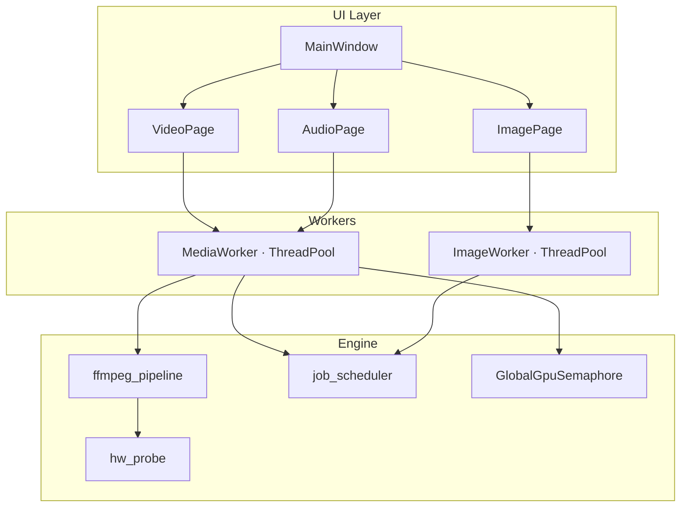

<p align="center">
  
</p>

<h1 align="center">Galaxy Media Pro</h1>
<p align="center"><strong>تبدیل ساده تصویر، ویدیو و صدا — با شتاب سخت‌افزار و موازی‌سازی هوشمند</strong></p>

<p align="center">
  <em>Simple image, video & audio conversion — hardware acceleration & smart parallelism</em>
</p>

<p align="center">
  نسخه <strong>3.0 Pro</strong> · Windows · PySide6 · FFmpeg GPL
</p>

<p align="center">
  <a href="docs/INDEX.md">مستندات</a> ·
  <a href="docs/USER_GUIDE.md">راهنمای کاربر</a> ·
  <a href="docs/INSTALL.md">نصب</a> ·
  <a href="LICENSE">License</a>
</p>

---

## ✨ چرا Galaxy Media Pro؟

| قابلیت | توضیح |
|--------|--------|
| **سه رسانه، یک رابط** | تصویر (PIL) · ویدیو/صدا (FFmpeg) در یک اپ یکپارچه |
| **شتاب GPU** | NVENC · AMF · QSV — تشخیص خودکار، fallback به CPU |
| **Tier هوشمند** | Full GPU · Encode-only GPU · Remux · CPU |
| **موازی‌سازی** | Sequential · Parallel · Smart (بر اساس CPU/GPU) |
| **دو زبان** | فارسی RTL + English LTR |
| **Portable** | یک EXE با FFmpeg داخلی — بدون نصب |

---

## 👤 توسعه‌دهنده

| | |
|---|---|
| **نام** | Ali Rashidi |
| **برند** | Write Your Way |
| **کانال تلگرام** | [@writeyourway](https://t.me/writeyourway) |
| **تماس** | [@a_ra_80](https://t.me/a_ra_80) |

اطلاعات کامل در صفحه **راهنما → درباره / Developer** داخل برنامه.

---

## 🚀 شروع سریع

### پیش‌نیاز

- Windows 10/11 · Python 3.11+ (برای توسعه)
- `ffmpeg.exe` در ریشه پروژه ([راهنمای FFmpeg](docs/FFMPEG_BUNDLE.md))

### اجرا از سورس

```powershell
pip install -r requirements.txt
python galaxy_ultimate.py
```

### ساخت Portable (یک فایل)

```powershell
.\build_portable.bat
# خروجی: dist\GalaxyMediaPro_Portable.exe
```

### QA کامل (توسعه‌دهندگان)

```powershell
pip install -r requirements-dev.txt
.\tools\run_qa.ps1 --full
```

---

## 📁 ساختار پروژه

```
MediaConverter/
├── galaxy/                 # ← موتور اصلی (UI + services + workers)
│   ├── core/               # constants, paths, utils, exceptions
│   ├── services/           # ffmpeg, pipeline, hw_probe, scheduler, settings
│   ├── workers/            # media_worker, image_worker, image_task
│   └── ui/                 # main_window, pages, theme, widgets
├── galaxy_i18n.py          # ترجمه FA/EN
├── galaxy_fonts.py         # فونت Vazirmatn + typography
├── galaxy_ultimate.py      # entry point (PyInstaller)
├── tests/                  # 247 تست pytest
├── tools/                  # verify, benchmark, qa_full, bootstrap
├── docs/                   # مستندات کامل
├── fonts/                  # فونت‌های باندل
├── ffmpeg.exe              # FFmpeg GPL (ضروری)
├── ffprobe.exe             # برای تست integration
├── archive/                # کد legacy — بدون استفاده در build
├── build_portable.bat
├── GalaxyConverter.portable.spec
├── LICENSE
├── pyproject.toml
└── requirements.txt
```

---

## ⚡ معماری (خلاصه)



---

## 🎞 فرمت‌های پشتیبانی‌شده

| نوع | فرمت‌ها |
|-----|---------|
| **تصویر** | JPG · PNG · WEBP · HEIC* · TIFF · GIF · BMP · ICO |
| **ویدیو** | MP4 · MKV · MOV · WEBM · AVI · GIF |
| **صدا** | MP3 · WAV · FLAC · AAC · M4A · OGG · OPUS · WMA |

\* HEIC در صورت نصب `pillow-heif`

---

## 🔧 شتاب سخت‌افزار

| GPU | Encoder | فیلتر GPU (Tier1) |
|-----|---------|-------------------|
| NVIDIA | h264/hevc NVENC | scale_cuda |
| AMD | h264/hevc AMF | vpp_amf |
| Intel | h264/hevc QSV | scale_qsv |

تنظیمات: **Settings → Pro mode → Performance**  
راهنمای کامل: [docs/ARCHITECTURE.md](docs/ARCHITECTURE.md)

---

## 📚 مستندات

| سند | موضوع |
|-----|--------|
| [docs/INDEX.md](docs/INDEX.md) | فهرست مرکزی مستندات |
| [docs/INSTALL.md](docs/INSTALL.md) | نصب، build، portable |
| [docs/USER_GUIDE.md](docs/USER_GUIDE.md) | راهنمای کاربر |
| [docs/DEVELOPMENT.md](docs/DEVELOPMENT.md) | توسعه و مشارکت |
| [docs/ARCHITECTURE.md](docs/ARCHITECTURE.md) | معماری فنی |
| [docs/TESTING.md](docs/TESTING.md) | QA و pytest |
| [docs/FFMPEG_BUNDLE.md](docs/FFMPEG_BUNDLE.md) | FFmpeg و GPL |
| [docs/CHANGELOG.md](docs/CHANGELOG.md) | تاریخچه نسخه |

---

## 🧪 کیفیت

```powershell
python tools/qa_full.py          # gate روزانه (unit)
python tools/qa_full.py --full   # + integration FFmpeg
python -m pytest tests -q        # 247 tests · ~70% coverage
```

| Gate | ابزار |
|------|--------|
| Lint | Ruff |
| Types | MyPy |
| Security | Bandit |
| Tests | pytest + pytest-qt |
| Acceptance | benchmark_matrix, verify_ffmpeg_caps |

CI: `.github/workflows/qa.yml` (Windows · Python 3.12)

---

## ⚖️ مجوز

| جزء | مجوز |
|-----|------|
| **کد اپ (Galaxy Media Pro)** | Proprietary — © Ali Rashidi · [LICENSE](LICENSE) |
| **FFmpeg** | GNU GPL — [gyan.dev](https://www.gyan.dev/ffmpeg/builds/) · [BtbN](https://github.com/BtbN/FFmpeg-Builds) |
| **PySide6 / Qt** | LGPL / Qt license |
| **Pillow و وابستگی‌ها** | مجوز هر بسته در PyPI |

Attribution FFmpeg در صفحه **Help → GPL** داخل برنامه.

---

## 🗂️ آرشیو

پوشه `archive/` شامل پروژه Phase 5 قدیمی است — **جزء build فعلی نیست**.  
جزئیات: [archive/README.md](archive/README.md)

---

## 🔗 Git (اولین راه‌اندازی)

```powershell
git init
git add .
git commit -m "Galaxy Media Pro 3.0 — initial release"
git remote add origin <your-repo-url>
git push -u origin main
```

`.gitignore` شامل `.cursor/`، `dist/`، `build/` و cacheهای QA است.

---

<p align="center">
  <strong>Galaxy Media Pro 3.0</strong><br>
  Ali Rashidi · <a href="https://t.me/writeyourway">@writeyourway</a> · <a href="https://t.me/a_ra_80">@a_ra_80</a><br>
  <em>ساخته‌شده برای کاربرانی که می‌خواهند تبدیل کنند — نه با FFmpeg CLI درگیر شوند.</em>
</p>
