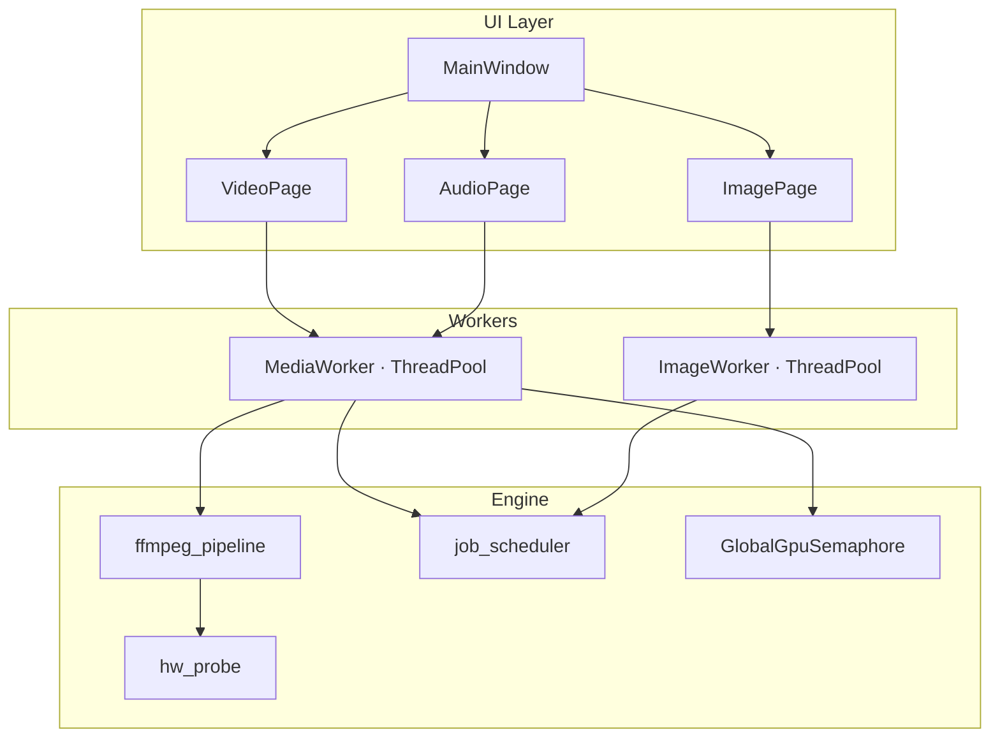

# Architecture — Galaxy Media Pro

**Language:** [English](#english) · [فارسی](#فارسی)

---

## English

### Layers

```
galaxy_ultimate.py          Entry (PyInstaller)
    └── galaxy.app.main     QApplication bootstrap
        └── GalaxyWindow    Shell + footer + navigation
            └── *Page       Image / Video / Audio / Settings / About
                └── *Worker ImageWorker | MediaWorker
                    └── services.*     FFmpeg · pipeline · scheduler
```

High-level diagram (same as README):



---

### Pipeline tiers (video)

| Tier | Condition | Path |
|------|-----------|------|
| **COPY** | `copy_streams` / fast_copy | `-c copy` |
| **CPU** | VP9/AV1/GIF · force_cpu · no GPU | libx264/libx265 |
| **TIER1** | GPU + full path (scale_cuda/…) | hw decode + gpu filter + hw encode |
| **TIER2** | GPU encode · CPU filters | hybrid |

**File:** `galaxy/services/ffmpeg_pipeline.py`  
**Selection:** `pick_pipeline_tier()` · `build_video_command()`

---

### Hardware probe

```
ffmpeg -encoders / -hwaccels / -filters
        ↓
SystemProfile { backends, gpu_devices, recommended_parallel }
        ↓
cache ~/.galaxy_converter/hw_cache.json  (TTL 24h)
```

**File:** `galaxy/services/hw_probe.py`

---

### Job scheduler

```python
compute_slots(app_settings, JobDescriptor) → int
GlobalGpuSemaphore.configure(gpu_slots)    # startup
GlobalGpuSemaphore.acquire/release()       # per GPU encode
per_job_cpu_threads(...)                   # FFmpeg -threads
```

| Job kind | Smart slots (typical) |
|----------|------------------------|
| Image | min(cpu-1, 6) · ThreadPool |
| Audio | min(cpu-1, 4) · ThreadPool |
| Video GPU | gpu_slots cap |
| Video CPU | min(cpu-1, 3) |

**File:** `galaxy/services/job_scheduler.py`

GPU acquire is interruptible by **Stop** (short acquire loop + `is_running` check) so parallel cancel does not block for minutes.

---

### Workers

#### MediaWorker (QThread)

- Sequential or `ThreadPoolExecutor`
- GPU sem → encode → release before CPU fallback
- `_run_ffmpeg` progress from stderr `time=`

#### ImageWorker (QThread)

- Sequential or `ThreadPoolExecutor` (no new process spawn — avoids multi-window on Windows)
- Top-level `convert_image_task` (Windows spawn-safe)
- Module-level output lock

#### Shutdown

UI idle flags and `QThread.isRunning()` can diverge briefly after finish. Window close / force-reset join workers (stop → wait → terminate-on-timeout) before dropping references.

---

### Settings schema

```json
{
  "language": "fa",
  "theme": "dark_cyan",
  "ui_mode": "simple|professional",
  "parallel_mode": "smart|sequential|parallel",
  "accel_mode": "auto|cpu|nvidia|amd|intel",
  "nvenc_preset": "p4",
  "max_parallel_jobs": 0,
  "cpu_threads": 0
}
```

**File:** `galaxy/services/settings.py`

---

### i18n

- `galaxy_i18n.py` — `STRINGS['fa'|'en']`
- UI: `I18n.t(key)`
- Workers: `WorkerI18n` (no Qt)

---

### Build / bundle

| Spec | Output |
|------|--------|
| `GalaxyConverter.spec` | onedir |
| `GalaxyConverter.portable.spec` | onefile + UPX |

Hidden imports: `hw_probe`, `ffmpeg_pipeline`, `job_scheduler`, `worker_i18n`, …

---

## فارسی

### لایه‌ها

همان درخت لایه‌ها و دیاگرام Mermaid بخش انگلیسی — موتور در `galaxy/` با entry در `galaxy_ultimate.py`.

### Pipeline tiers (ویدیو)

| Tier | شرط | مسیر |
|------|-----|------|
| **COPY** | `copy_streams` / fast_copy | `-c copy` |
| **CPU** | VP9/AV1/GIF · force_cpu · بدون GPU | libx264/libx265 |
| **TIER1** | GPU + مسیر کامل | hw decode + gpu filter + hw encode |
| **TIER2** | encode روی GPU · فیلتر CPU | hybrid |

### Hardware probe / Job scheduler / Workers

- probe → `SystemProfile` + cache ۲۴ ساعته
- `GlobalGpuSemaphore` برای encode موازی GPU؛ acquire با Stop قطع‌پذیر است
- ImageWorker بدون spawn پردازش جدید (جلوگیری از چند پنجره در Windows)
- `closeEvent` حتی وقتی UI idle است worker در حال اجرا را join می‌کند

### i18n

کلیدها در `galaxy_i18n.py` برای **fa** و **en**؛ Workers با `WorkerI18n` بدون Qt.

---

[← Docs index](INDEX.md) · [Development](DEVELOPMENT.md) · [Testing](TESTING.md)
